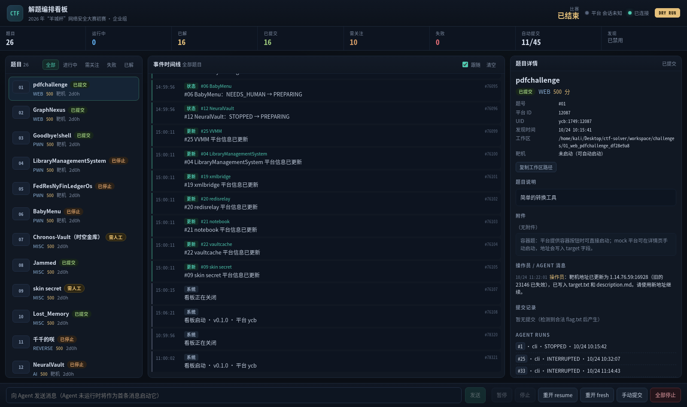

# CTF 自动化解题编排系统（2026 羊城杯）

通用的 CTF 自动化解题编排系统，当前适配 2026 羊城杯企业组（DASCTF，competition 1749）。
部署在 Kali（Linux）；解题内核与平台 adapter 解耦，目前提供本地 **mock 平台**（完整 e2e）与 **ycb / ctfd adapter 接口位置**。



<sub>真实赛段看板：左侧题目与状态，中间实时事件时间线，右侧题目详情、提交记录与 Agent 运行记录。</sub>

> 功能：题目发现、附件下载、每题独立 Claude Agent、FlagWatcher 自动识别 `flag.txt`、
> 校验/去重/额度控制/串行提交，以及看板上的实时观测与人工介入。
> 提交结果按 `accepted / already_solved / rejected / rate_limited / session_expired / unknown`
> 分类处理；未知结果不自动重试，转人工确认。
> 默认 `dry_run=true`（只识别不提交），自动提交上限 45（平台硬上限 50）。

## 快速开始（mock e2e）

```bash
cd ctf-solver  # 或你克隆后的仓库目录

# 首次：创建 Python 3.11 venv 并安装依赖（也可用 ./run.sh 自动完成）
/usr/bin/python3.11 -m venv .venv
.venv/bin/pip install -r requirements-dev.txt

# 真实平台还需要 Playwright 的 Chromium（约 150MB；也可用系统 chromium）
.venv/bin/playwright install chromium

# 启动内置 mock 平台 + 看板
.venv/bin/python run.py --mock
```

打开：

- 看板：<http://127.0.0.1:8787/>
- mock 平台：<http://127.0.0.1:8898/1749/login>（局域网用 `http://<Kali-IP>:8898/1749/login`；账号 `player` / 密码 `mock-pass-2026`）

`run.py --mock` 会把发现周期临时缩短为 3 秒、确认轮次仍为 2 轮，因此约 6~8 秒后三题会出现在左侧列表，并伴随 `challenge.discovered`、`status.changed` 等实时事件。

## 常用命令

```bash
.venv/bin/python run.py --mock                 # mock 平台 + 看板（发现后自动启动真实 Agent）
YCB_AUTO_START=false .venv/bin/python run.py --mock   # 只发现不启动 Agent（观察/联调看板）
.venv/bin/python run.py --mock --live          # 关闭 dry_run（验证提交链路后才使用）
.venv/bin/python run.py --platform ycb         # 连接真实平台（默认 dry_run，只识别不提交）
YCB_HEADLESS=0 .venv/bin/python run.py --platform ycb   # 需要人工输验证码时（有桌面/X）
.venv/bin/python run.py --mock --mock-port 8899 --port 8787
.venv/bin/python run.py --check                # 只校验配置
./run.sh --mock                                # 首次自动装依赖后启动
.venv/bin/python -m pytest                     # 测试（不调用真实 Claude / 真实平台）
.venv/bin/python scripts/smoke_agent.py        # Agent 冒烟：真实 Claude 解一道本地题并写 flag.txt
```

`scripts/smoke_agent.py` 会真实调用本机 `claude` CLI（消耗额度），在 `/tmp` 下建独立临时库，
不连接平台、不提交、不使用平台凭据；正常约 20 秒完成，成功后打印 flag 与现场目录。

| 服务 | 默认地址 | 说明 |
| --- | --- | --- |
| 看板 | `0.0.0.0:8787` | FastAPI + WebSocket，单 worker；局域网内可直接访问 |
| mock 平台 | `0.0.0.0:8898` | 由 `--mock` 作为子进程启动，退出时自动回收；局域网可访问 |

## 安全约定

- **真实平台凭据只放 `.env`（`chmod 600`）**，通过 `YCB_USERNAME` / `YCB_PASSWORD` 注入；不写进 `config.toml`，不入库，不传给 Agent。
- `var/`（SQLite、Playwright profile、日志、run 原始流）为 `0700`；数据库 `0600`。`var/profile` 永不注入 Agent 环境。
- 浏览器 profile 由 `var/profile.lock`（flock）跨进程独占；不要把 Windows 上旧的 Chrome profile 拷到 Kali。
- 登录失败/验证码识别失败时自动保存截图与 HTML 到 `var/debug/platform/`（0600），并暂停自动重试 5 分钟转人工。
- 被动网络录制只保留 `player/ctf`、`answer-panel` 等答题 JSON，不保存请求头/Cookie/Authorization，敏感字段递归打码。
- 看板监听 `0.0.0.0:8787` 供局域网访问；默认不校验 token，局域网内任何设备可直接查看和操作。如需启用校验，在 `.env` 设置 `YCB_DASH_TOKEN`（首次用 `?token=...` 打开会写入 7 天 HttpOnly cookie，`/api` 与 WebSocket 均校验）。
- 看板所有不可信文本用 `textContent` 渲染，配合严格 CSP；当前 `server.unmask_flags = true`，flag 显示明文（敏感键仍打码）。
- 题目说明/附件/远程输出一律按不可信数据处理（工作区 `description.md` 顶部有警告，每题 `CLAUDE.md` 与 `--append-system-prompt` 双重约束）。
- Agent 进程环境会剥离 `YCB_*`、`MOCK_*`、`CLAUDECODE*` / `CLAUDE_CODE_*` 标记与平台凭据；cwd 固定为题目工作区，不注入 profile/DB 路径。
- 自动提交上限 `45`（平台硬上限 50）；`flag.txt` 是唯一自动提交来源；首日默认 `dry_run=true`。

`.env` 示例：

```dotenv
# 仅真实平台需要；mock 不需要
YCB_USERNAME=your-account
YCB_PASSWORD=your-password
# 可选：设置后看板启用 token 校验；不设置则局域网内可直接访问
# YCB_DASH_TOKEN=long-random-token
```

## 目录结构

```text
run.py / run.sh          启动入口（mock 子进程、单实例锁、uvicorn）
scripts/smoke_agent.py   真实 Agent 冒烟（本地临时题，不连平台）
config.toml              非敏感配置（平台、周期、Agent prompt、提交策略）
ycb/
  config.py              配置加载（TOML + .env + 环境变量）
  models.py              归一化领域模型（Challenge/Target/Attachment/Event…）
  db.py                  SQLite（WAL、CAS 状态迁移、事件、消息、提交、runs）
  events.py              进程内事件总线（seq、持久化、断线补发、队列丢弃）
  adapters/              平台协议 + mock / ycb / ctfd(占位) + ycb 选择器 TOML
  platform/              Playwright 持久化浏览器、优先级 actor、ddddocr、网络录制
  scheduling/            发现循环 + 状态机 + 每题 Agent 生命周期（manager.py）
  agents/                CLI backend、AgentSpec、事件归一化/打码、每题 CLAUDE.md
  submission/            flag.txt 校验、FlagWatcher、去重/额度/提交队列与恢复
  workspace/layout.py    安全目录/附件命名、题目工作区
  web/                   FastAPI 应用、REST、WebSocket、看板前端
mock_platform/           本地 mock 比赛平台（登录/验证码/附件/容器/提交限额）
tests/                   单元 / 集成 / mock e2e 测试
workspace/challenges/    每题工作区（运行时生成，git 忽略）
var/                     数据库/日志/锁（运行时生成，git 忽略）
```

## 看板使用

- 左侧题目列表支持筛选；点击题目后，中栏时间线自动聚焦该题，右栏显示详情、附件、消息、提交记录与 run 记录。
- 新题入库后按 `agent.auto_start` 自动启动 Agent（默认开启，1~2 秒错峰）；也可在题目未运行时直接发消息，消息会作为首条任务启动 Agent。
- Agent 运行中发消息会写入其 stdin；暂停/停止/重开（`resume` 保留原会话，`fresh` 新会话）均可在看板操作，“全部停止”需二次确认。
- 时间线实时展示 init、文本、思考、工具调用/结果、结果、停滞、退出、flag 检测、提交入队/重试/结果等事件；当前 flag 显示明文，敏感键（cookie/token/password 等）仍打码。
- FlagWatcher 每 1 秒检查各题 `flag.txt`，同一内容稳定 1 秒且校验通过后入队。`dry_run=true` 时写入 `dry_run` 记录并提示，不请求平台；关闭后走真实提交队列。
- 手动提交遵守同样的校验、去重与 dry_run 规则，并等待平台结果（超时则返回 pending，结果仍会出现在时间线）。
- 提交结果：`accepted/already_solved` → `SUBMITTED` 并停 Agent；`rejected` → 回到 `SOLVED` 并把平台消息反馈给 Agent（连续 3 次告警、5 次转人工）；`unknown` 只复查平台是否已解，不自动重试，否则转人工。

## mock 平台设计（用于验证编排链路）

- 登录：`/1749/login`，4 位图形验证码（PIL），验证码一次性、5 分钟过期；API 调试模式暴露答案给 adapter（真实平台绝不启用）。
- 题目：3 道，覆盖 zip + base64、嵌套 tar/zip、容器 TCP echo 服务；附件在启动时确定性生成。
- 提交：全局 50 次硬上限、1 秒最小间隔、动态扣分；支持 `accepted / rejected / already_solved / rate_limited`。
- 附件内包含 `CLAUDE.md` 等提示注入诱饵，用于验证工作区隔离与 Agent 防护。
- mock 状态在内存中，重启重置；适配器 cookie 持久化到 `var/mock/cookies.json`。

## 接入其他比赛 / 平台

解题内核不感知具体平台，换平台的改动集中在 `ycb/adapters/` 和配置：

| 场景 | 改动 |
| --- | --- |
| 同一 DASCTF 平台的另一场比赛 | 只改 `config.toml` 与 `.env`，必要时更新选择器 |
| CTFd 系平台 | 补全 `ycb/adapters/ctfd.py`（目前是占位） |
| 其他自研/浏览器平台 | 新增 adapter + 选择器 TOML + 注册一行 |

### 同一 DASCTF 平台

```toml
[platform]
active = "ycb"
competition_id = "新比赛 ID"
base_url = "https://新域名"

[submission]
flag_regex = "^(DASCTF\\{[^{}\\r\\n]{4,200}\\}|flag\\{[^{}\\r\\n]{4,200}\\})$"
max_auto_submits = 45        # 按新平台硬上限调整
dry_run = true               # 先跑 dry_run

[schedule]
start_time = "2026-xx-xxT10:00:00+08:00"
end_time = "2026-xx-xxT14:00:00+08:00"
```

`.env` 换成新账号（`YCB_USERNAME` / `YCB_PASSWORD`）。后端仍是 `slab-match` 接口时，`ycb` 适配器可直接复用；页面结构变化只改 `ycb/adapters/selectors/ycb.toml`。注意 `YCBAdapter.submit()` 会把 `DASCTF{abc}` 剥成 `abc` 再提交（`ycb/adapters/ycb.py` 的 `_answer_value`），这是该平台答题框的语义，换到其他平台不要照搬。

### CTFd 系平台

`ycb/adapters/ctfd.py` 需要按 `PlatformAdapter` 协议补全。CTFd 一般有标准 API，不需要浏览器：

- `GET /api/v1/challenges` → 题目列表
- `GET /api/v1/challenges/{id}` → 描述、附件、`solved_by_me`
- `POST /api/v1/challenges/attempt`，body `{"challenge_id": id, "submission": flag}` → `correct / incorrect / already_solved / ratelimited`
- 认证：请求头 `Authorization: Token <CTFD_TOKEN>`

方法对应关系：

| 方法 | CTFd |
| --- | --- |
| `login` / `health` | 校验 token，维护 `self._session` |
| `discover` | `GET /api/v1/challenges` → `Challenge` |
| `fetch_detail` | `GET /api/v1/challenges/{id}` |
| `download` | 下载 `files` 中的 URL |
| `submit` | `POST /api/v1/challenges/attempt`，映射为 `accepted/rejected/already_solved/rate_limited/unknown` |
| `is_solved` | 详情里的 `solved_by_me` |
| `ensure_target` | 普通 CTFd 返回 `None`；装了 ctfd-whale 再接 `/api/v1/plugins/ctfd-whale/container` |

CTFd 提交**完整 flag**，不要调用 `_answer_value()` 剥壳。适配器需要提供 `session` 属性（返回 `SessionState`）和 `capabilities`，发现循环与看板会直接访问。

### 其他平台

1. 新建 `ycb/adapters/foo.py`，浏览器型平台继承 `BrowserAdapterBase`，纯 API 平台直接参考 `ycb.py` 的 `_http_api` / `_submit_via_api`；
2. 新建 `ycb/adapters/selectors/foo.toml`，按 `ycb.toml` 的结构填登录、题目、详情、附件、容器、提交、toast、已解标记等选择器；
3. 在 `ycb/adapters/registry.py` 的 `_BUILTINS` 加一行，或调用 `register("foo", "ycb.adapters.foo", "FooAdapter")`；
4. 把平台名加进 `run.py` 的 `--platform` 可选项（当前是 `mock / ycb / ctfd`）。

`discover()` 返回的 `Challenge` 至少需要 `uid`、`platform`、`competition_id`、`platform_id`、`title`；分类、分值、描述、附件、`flag_regex`、容器能力按平台能给多少填多少（模型见 `ycb/models.py`）。

### 通用检查

- 新平台的 flag 格式不同则改 `submission.flag_regex`；每题格式不同就在 `discover()` 里给 `Challenge.flag_regex` 赋值。
- 提交限额必须小于平台硬上限；先 `dry_run=true` 验证识别、去重和额度控制，再关闭。
- 只有平台明确返回成功才记 `accepted`；`unknown` 不自动重试，转人工。
- 赛段未开始/未报名时 `discover()` 应返回空列表，不要抛异常。
- 账号密码/token 只放 `.env` 或环境变量，不写进 `config.toml`、不入库、不传给 Agent。
- 适配器测试参考 `tests/test_mock_adapter.py`、`tests/test_ycb_parse.py`、`tests/test_ycb_submit.py`；先 `run.py --check` 校验配置，再用 `--dry-run` 灰度。

## 已知边界

- 答题页入口通过只读的 `match/open/stage-list` 定位 CTF 赛段，再导航到
  `/{competition}/competePage/{stageId}`；赛段 `PENDING`/`END` 时 `discover()` 直接返回空列表。
  换比赛或平台改版后，需按 `var/debug/platform/` 的快照重新校准容器/提交选择器。
- 真实平台账号需要已报名/满足赛段 `entryCondition`；未报名时即使赛段开始也进不了答题页。
- `YCBAdapter.submit()` 已实现（浏览器 actor 内填表 + 点击提交，响应/toast/页面三源判定），
  但提交输入框、按钮、toast、已解标记的选择器需在真实题目放出后按 `var/debug/platform/`
  快照校准；判定不确定时返回 `unknown` 并保留截图，绝不猜成功。
- FlagWatcher 在 Agent 运行中也会工作，检测到稳定 flag 后由提交流程停 Agent；人工停止/暂停
  仍按操作意图置为 STOPPED/PAUSED。进程重启时，`pending` 提交一律标为 `unknown` 并复查平台
  状态，不会盲目重试。
- Claude CLI 使用 `--input-format stream-json`，一个进程可持续接收多条操作员消息；卡死由
  `stall_warn_seconds`/`stall_interrupt_seconds` 看门狗兜底（默认 10/30 分钟）。
- 原始流保存在 `var/runs/run-<id>.jsonl`（0600，50MB 轮转），删除/轮转由 backend 自行管理。
- 单实例：同一份 `var/` 只允许一个进程（`var/ycb.lock`）。
